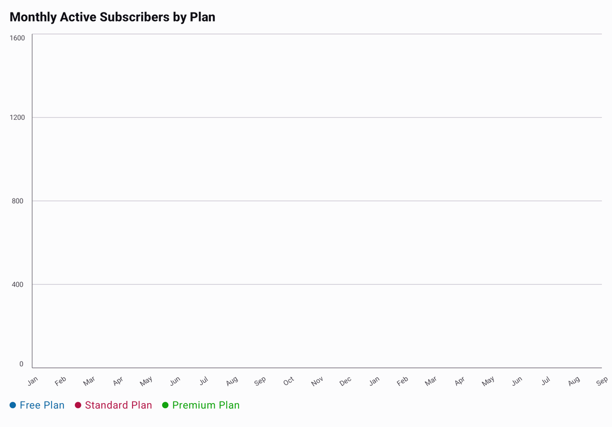
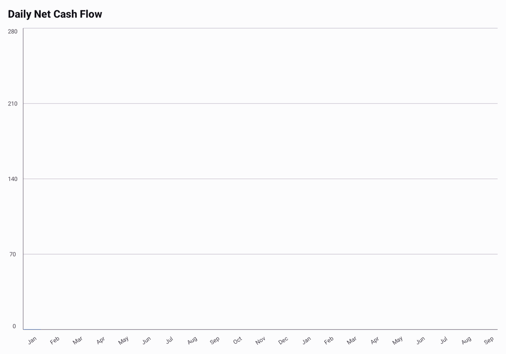

<p align="center">
  
  
</p>

<p align="center">
  <a href="https://central.sonatype.com/artifact/io.github.hdcharts/charts/overview">
    
  </a>
  <a href="https://central.sonatype.com/repository/maven-snapshots/io/github/hdcharts/charts/maven-metadata.xml">
    
  </a>
  
  
  
</p>

<p align="center">
  A Kotlin Multiplatform chart library built with Compose Multiplatform.
</p>

<p align="center">
  <picture>
    <source
      media="(prefers-color-scheme: dark)"
      srcset="sample/androidApp/src/screenshotTestDebug/reference/io/github/hdcharts/app/screenshot/ReadmeScreenshotTestKt/ReadmeShowcasePreview_README%20dark_278d6fe8_0.png"
    />
    
  </picture>
</p>

---

## 📚 Documentation
https://charts.hdcode.dev/snapshot/wiki

## 🟢 Interactive Demo
https://charts.hdcode.dev/demo/snapshot/

## 🏀 Playground
https://charts.hdcode.dev/playground

## Get Started

This README covers HDCharts 3.x. Replace `<version>` with the 3.x version you use.

```kotlin
dependencyResolutionManagement {
    repositories {
        mavenCentral()
    }
}
```

### All chart types

Use the umbrella artifact when you want all chart types with the simplest setup.

```kotlin
commonMain.dependencies {
    implementation("io.github.hdcharts:charts:<version>")
}
```

### Individual chart modules

Use independent modules when you want only specific chart types and smaller dependency footprint.

```kotlin
commonMain.dependencies {
    implementation("io.github.hdcharts:line:<version>")
    implementation("io.github.hdcharts:pie:<version>")
    implementation("io.github.hdcharts:bar:<version>")
    implementation("io.github.hdcharts:histogram:<version>")
    implementation("io.github.hdcharts:stacked-bar:<version>")
    implementation("io.github.hdcharts:stacked-area:<version>")
    implementation("io.github.hdcharts:radar:<version>")
    implementation("io.github.hdcharts:gauge:<version>")
}
```

### BOM

Use BOM for version alignment where Gradle platforms are supported.
For KMP `commonMain`, keep explicit versions as shown above.

```kotlin
dependencies {
    implementation(platform("io.github.hdcharts:bom:<version>"))
    implementation("io.github.hdcharts:line")
    implementation("io.github.hdcharts:pie")
    implementation("io.github.hdcharts:bar")
    implementation("io.github.hdcharts:histogram")
    implementation("io.github.hdcharts:stacked-bar")
    implementation("io.github.hdcharts:stacked-area")
    implementation("io.github.hdcharts:radar")
    implementation("io.github.hdcharts:gauge")
}
```

## Example

Show subscriber counts by plan and their combined total with `StackedAreaChart`.

<p align="center">
  
</p>

```kotlin
import androidx.compose.foundation.layout.fillMaxWidth
import androidx.compose.foundation.layout.height
import androidx.compose.runtime.Composable
import androidx.compose.ui.Modifier
import androidx.compose.ui.unit.dp
import io.github.hdcharts.core.model.toChartData
import io.github.hdcharts.stackedarea.StackedAreaChart

@Composable
fun SubscribersByPlanChart() {
    val months = listOf("Jan", "Feb", "Mar", "Apr", "May", "Jun", "Jul", "Aug", "Sep", "Oct", "Nov", "Dec")
    val dataSet = listOf(
        "Free Plan" to listOf(
            206.0, 233.0, 255.0, 260.0, 300.0, 351.0, 353.0,
            362.0, 398.0, 429.0, 484.0, 521.0, 503.0, 526.0,
            579.0, 601.0, 622.0, 642.0, 655.0, 698.0, 741.0,
        ),
        "Standard Plan" to listOf(
            70.0, 102.0, 139.0, 170.0, 207.0, 201.0, 197.0,
            260.0, 298.0, 298.0, 321.0, 336.0, 372.0, 446.0,
            454.0, 436.0, 471.0, 503.0, 529.0, 561.0, 571.0,
        ),
        "Premium Plan" to listOf(
            42.0, 104.0, 189.0, 254.0, 285.0, 353.0, 432.0,
            489.0, 555.0, 479.0, 397.0, 381.0, 409.0, 375.0,
            360.0, 348.0, 335.0, 345.0, 329.0, 293.0, 288.0,
        ),
    ).toChartData(categories = List(21) { months[it % months.size] })

    StackedAreaChart(
        data = dataSet,
        title = "Monthly Active Subscribers by Plan",
        modifier = Modifier
            .fillMaxWidth()
            .height(260.dp),
    )
}
```

Unless defined locally, `dataSet` refers to the data from the first example.

## Chart API

### Sizing

Use the chart composable's `modifier` to set its size within the parent's constraints.
The plot fills the available bounded space after the heading, legend, and content padding.
With one unbounded axis, the plot derives a square from the bounded axis; with both axes
unbounded, the plot uses a 200.dp fallback. Parent constraints still apply.

```kotlin
LineChart(
    data = dataSet,
    modifier = Modifier
        .fillMaxWidth()
        .height(260.dp),
)
```

### Surrounding chrome

Background, shadow, shape, and outer spacing are not applied by the chart. Wrap the chart in
any Compose surface to add chrome.

```kotlin
Card(modifier = Modifier.padding(16.dp)) {
    LineChart(
        data = dataSet,
        modifier = Modifier.fillMaxWidth().height(260.dp),
    )
}
```

### Content spacing

`ChartContainerDefaults.style()` returns a `ChartContainerStyle` with `styleTitle`,
`styleSubtitle`, and `contentPadding`. Set `contentPadding` to change the internal
spacing for the heading, axes, legend, and plot.

```kotlin
LineChart(
    data = dataSet,
    modifier = Modifier.fillMaxWidth().height(260.dp),
    style = LineChartDefaults.style(
        chartContainerStyle = ChartContainerDefaults.style(contentPadding = 8.dp),
    ),
)
```

### Titles and subtitles

Pass `title` and `subtitle` directly to the chart. A subtitle stays visible during
selection; a null or blank subtitle reserves no space.

```kotlin
LineChart(
    data = dataSet,
    title = "Monthly Active Subscribers by Plan",
    subtitle = "Monthly totals · All plans",
    modifier = Modifier.fillMaxWidth().height(260.dp),
)
```

### Style per chart

Each chart module exposes its own `*Defaults.style()` factory. Use named arguments to customize
only the parts you need. This example sets the line, points, and axis labels; other settings
keep their defaults. Zoom controls appear when a dense chart is expanded to its scrollable view.

```kotlin
LineChart(
    data = dataSet,
    title = "Monthly Active Subscribers by Plan",
    modifier = Modifier.fillMaxWidth().height(260.dp),
    style = LineChartDefaults.style(
        line = LineChartDefaults.line(
            color = Color(0xFF1E88E5),
            strokeWidth = 2.dp,
            bezier = true,
        ),
        points = LineChartDefaults.points(color = Color(0xFF1E88E5), size = 4.dp, visible = true),
        axes = AxesDefaults.style(
            lines = AxisLinesDefaults.style(color = Color.Gray, lineWidth = 1.dp),
            yLabels = AxisLabelDefaults.style(color = Color.Gray, size = 12.sp, maxCount = 5),
            xLabels = AxisLabelDefaults.style(color = Color.Gray, size = 12.sp, maxCount = 7),
        ),
        zoomControlsVisible = true,
    ),
)
```

### Gradients

Use `ChartGradients.horizontal()` with `GradientSpan.Plot` to spread one gradient
across the whole bar chart: blue on the left, purple in the middle, and orange
on the right.

<p align="center">
  
</p>

```kotlin
import androidx.compose.ui.graphics.Color
import io.github.hdcharts.bar.BarChart
import io.github.hdcharts.core.style.BarChartDefaults
import io.github.hdcharts.core.style.ChartGradients
import io.github.hdcharts.core.style.GradientSpan

val values = listOf(
    83.0, 89.0, 87.0, 115.0, 146.0, 135.0, 133.0,
    139.0, 145.0, 182.0, 195.0, 169.0, 188.0, 224.0,
    234.0, 246.0, 242.0, 232.0, 259.0, 280.0, 279.0,
)
val months = listOf("Jan", "Feb", "Mar", "Apr", "May", "Jun", "Jul", "Aug", "Sep", "Oct", "Nov", "Dec")
val barData = values.toChartData(
    categories = List(values.size) { months[it % months.size] },
    seriesName = "Daily Net Cash Flow",
)

BarChart(
    data = barData,
    title = "Daily Net Cash Flow",
    modifier = Modifier.fillMaxWidth().height(260.dp),
    style = BarChartDefaults.style(
        bars = BarChartDefaults.bars(
            gradient = ChartGradients.horizontal(
                colors = listOf(Color(0xFF1E89E6), Color(0xFF9B4EDD), Color(0xFFEA7A2E)),
                span = GradientSpan.Plot,
            ),
        ),
    ),
)
```

See [Gradients](docs/wiki/gradients.md) for per-shape gradients, fades, and other
supported chart types.

### Fixed Y-axis range

By default the Y-axis is derived from the data, which can make small fluctuations look
exaggerated when the axis doesn't start at zero. Set `range` on `*Defaults.style()` to pin
`min`, `max`, or both, independently of one another; whichever bound you leave `null` keeps
deriving from the data.

```kotlin
LineChart(
    data = dataSet,
    modifier = Modifier.fillMaxWidth().height(260.dp),
    style = LineChartDefaults.style(
        range = LineChartDefaults.range(min = 0.0, max = 800.0),
    ),
)
```

`BarChart` exposes the same `range` block on `BarChartDefaults.style()`; its automatic
range includes zero. Fixed bounds must be finite. If both are set and `min >= max`,
the chart uses its automatic range.

### Selection

Use `rememberChartSelection()` to hoist selection. The chart calls back into it; you read
`selectedIndex` to drive external UI such as legends or summary cards. It is `null`
when nothing is selected and refers to the original data index, including in compact mode.

```kotlin
val selection = rememberChartSelection()
val values = listOf(42.0, 38.0, 45.0, 51.0, 47.0, 54.0, 49.0)

LineChart(
    data = values.toChartData(),
    modifier = Modifier.fillMaxWidth().height(260.dp),
    selection = selection,
)

val selected = selection.selectedIndex?.let { values.getOrNull(it) }
Text(selected?.let { "Selected: $it" } ?: "Select a point")
```

### Responsive layout

Compose the chart with any layout, including `Row`, `Column`, `LazyColumn`, or `BoxWithConstraints`.
Set a height for each chart in a vertical layout so both have room to render.

```kotlin
Column(modifier = Modifier.fillMaxSize().padding(16.dp)) {
    LineChart(
        data = dataSet,
        modifier = Modifier.fillMaxWidth().height(220.dp),
    )
    Spacer(modifier = Modifier.height(16.dp))
    BarChart(
        data = dataSet.series.first().values.toChartData(categories = dataSet.categories),
        modifier = Modifier.fillMaxWidth().height(220.dp),
    )
}
```

### Animation and interaction

`animateOnStart` controls the initial reveal animation. `interactionEnabled = false` disables
user gestures, selection input, and chart controls; programmatic selection still renders.
Use it to embed a chart inside a tappable card.

`LineChart` morphs between data updates with the same point and series counts. For a sliding
window that drops old points and appends new ones, use `LiveLineChart`. It is display-only
and exposes no selection or gesture controls.

```kotlin
LineChart(
    data = dataSet,
    modifier = Modifier.fillMaxWidth().height(260.dp),
    animateOnStart = true,
    interactionEnabled = false,
)
```

## Contributing
See [CONTRIBUTING.md](CONTRIBUTING.md) for contribution guidelines.

## License
[MIT](LICENSE)
