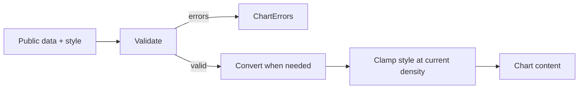

# Entry Seam and Chart Policy

Indexed `ChartData` enters through `ChartEntry` in `charts-core`. A chart declares a `ChartSpec`
with its validation policy, conversion, and style clamping. Charts with other data models own
these operations in their chart entry and reuse shared helpers where the inputs fit.

## Input flow

`ChartEntry` returns after displaying errors, so invalid input never reaches conversion or content.
The chart resolves selection against public data before conversion.

Validation is remembered against the data, spec, a value-based snapshot of the validation inputs,
density, and any additional errors. Equivalent validation values reuse the result even when a
caller creates a new style instance. Conversion is remembered against the spec, data, and title;
clamping against the spec, full style, and density.

See [Pipeline and Stage Ownership](pipeline.md) for layout and drawing responsibilities.

## ChartSpec

A spec keeps the chart's input decisions together:

| Member | Responsibility |
|---|---|
| `policy` | Selects checks and maps the style to their inputs |
| `convert` | Produces `ChartRenderData`; the default wraps the caller's data and title |
| `clamp` | Delegates to the chart style's `clamp(density)` extension |

Override conversion when the renderer needs a different data shape. Stacked bar, for example,
transposes series into bars. Style-clamping rules stay with the style blocks.

[`LineChartEntry.kt`](https://github.com/HDCharts/charts/blob/main/charts-line/src/commonMain/kotlin/io/github/hdcharts/line/internal/LineChartEntry.kt)
shows a spec and entry shared by `LineChart` and `LiveLineChart`. Their content differs, so the
entry accepts a content lambda.

## ChartPolicy

`ChartPolicy<S>` declares the checks for indexed series and supplies their style inputs.

| Field | Responsibility |
|---|---|
| `SeriesRule.Single` | Requires one series and matches explicit colors to its values |
| `SeriesRule.Multiple` | Validates aligned series; declares minimum values, negative-value rules, stacking, and expected colors |
| `colorCount` | Reads the explicit palette size; zero skips color matching |
| `range` | Supplies range bounds for validation; null means this capability does not apply |
| `axes` | Supplies both X- and Y-label validation settings; null means this capability does not apply |

`RangeInputs(min = null, max = null)` declares an automatic range. That differs from a null range
mapper, which declares no range validation.

`SeriesRule.Multiple.expectedColors` derives the expected palette size from data. Returning null
skips matching for that dataset. Radar uses this to check colors only when it has multiple series.

The shared policy checks data shape, range, then axis labels. [Validation
Errors](validation-errors.md) describes those checks and their messages.

Current indexed-policy expectations live in
[`ChartPolicyConformanceTest`](https://github.com/HDCharts/charts/blob/main/charts/src/commonTest/kotlin/io/github/hdcharts/charts/ChartPolicyConformanceTest.kt).
The test lists its cases explicitly, so adding a spec also requires adding its test case.

## Other data models

A chart with different input semantics owns validation in its entry. Scatter checks independent
X/Y points, Heatmap checks a labeled matrix with optional missing cells, and Waterfall checks
ordered changes and running totals. Use their entry files as examples when a new model needs its
own contract.

Reuse `ChartErrors`, axis-label validation, range validation, and the selection lifecycle where
applicable. Pass validated data directly to content when conversion adds no value. Remember
validation against every input it reads, including relevant style values and density.

An indexed chart can also supply `additionalErrors` to `ChartEntry` for checks outside the shared
policy, such as Segmented Ring Gauge's capacity and total checks.

## Adding a chart or changing a rule

- Declare its policy, conversion, and clamping in the chart entry. Indexed policies use `ChartSpec`.
- Update [ChartPolicyConformanceTest](https://github.com/HDCharts/charts/blob/main/charts/src/commonTest/kotlin/io/github/hdcharts/charts/ChartPolicyConformanceTest.kt) for an indexed policy and the chart's tests for its own input
  rules. The umbrella owns the shared conformance test because it depends on the chart modules.
- Put shared checks in the existing validation helpers; keep model-specific checks with the chart.
- Test that invalid input renders errors and valid input reaches content with a drawable style.
- Update [Validation Errors](validation-errors.md) when introducing a new kind of validation.

## Tests

| Behavior | Tests |
|---|---|
| Policy mappers enable their checks | [ChartPolicyTest](https://github.com/HDCharts/charts/blob/main/charts-core/src/commonTest/kotlin/io/github/hdcharts/core/internal/ChartPolicyTest.kt) in `charts-core` |
| Invalid input stops before content; clamping uses current density | [ChartEntryTest](https://github.com/HDCharts/charts/blob/main/charts-core/src/commonTest/kotlin/io/github/hdcharts/core/internal/ChartEntryTest.kt) in `charts-core` |
| Indexed policies match expected rules | [ChartPolicyConformanceTest](https://github.com/HDCharts/charts/blob/main/charts/src/commonTest/kotlin/io/github/hdcharts/charts/ChartPolicyConformanceTest.kt) in `charts` |
| Model-specific validation and displayed errors | Each chart's tests |
