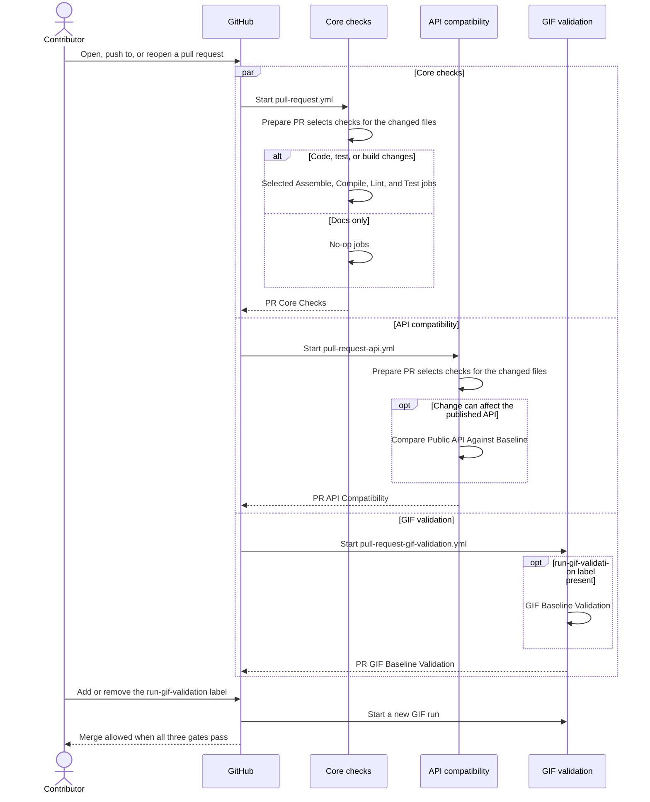

# Pull Requests

Every pull request runs three independent workflows: core checks, API compatibility, and opt-in
GIF validation. Each one checks the immutable merge commit (`github.sha`) of the event that
started it, and each has its own concurrency group, so a new push cancels only its own
older run.



## Workflows

| Workflow | File | Runs on |
| --- | --- | --- |
| Core checks | [`pull-request.yml`](https://github.com/HDCharts/charts/blob/main/.github/workflows/pull-request.yml) | opened, synchronize, reopened |
| API compatibility | [`pull-request-api.yml`](https://github.com/HDCharts/charts/blob/main/.github/workflows/pull-request-api.yml) | opened, synchronize, reopened |
| GIF validation | [`pull-request-gif-validation.yml`](https://github.com/HDCharts/charts/blob/main/.github/workflows/pull-request-gif-validation.yml) | opened, synchronize, reopened, labeled, unlabeled |

## Jobs

| Job | What it does |
| --- | --- |
| `Prepare PR` | Runs `.github/scripts/ci-impact.py` to choose the checks and writes the decision to the job summary; see [Check selection](validation-matrix.md#check-selection). The core workflow also runs the self-tests of the CI scripts. |
| `Assemble` | Runs `./gradlew ciAssemble`. |
| `Compile` | Runs `./gradlew ciCompile`, including the `smoke-line` consumer. |
| `Lint` | Runs `./gradlew ktlintCheck buildSrcKtlintCheck ciCheckImpactGraph`. The last task fails when `ci-impact.py` misses a Gradle project or project dependency. |
| `Test` | Runs the selected JVM, Android instrumented, screenshot, Wasm, and iOS test jobs for the selected modules; see [Validation Matrix](validation-matrix.md). Each job uploads Gradle's HTML and XML reports. |
| `Compare Public API Against Baseline` | Runs `./gradlew apiCompatibilityCheck` against the latest release tag; see [API Compatibility](api-compatibility.md). |
| `GIF Baseline Validation` | Records the docs GIF scenarios on an Android emulator and compares them with `gif-baselines`. |

## Checkout depth

`Assemble`, `Compile`, `Lint`, and `Test` clone the single merge commit they check. Two jobs need the
full history instead.

| Job | `fetch-depth` | Reason |
| --- | --- | --- |
| `Prepare PR`, both workflows | `0` | `.github/scripts/ci-impact.py` diffs the base and head SHAs, so both have to exist locally. |
| `Compare Public API Against Baseline` | `0` | The check lists `git tag` for the baseline release and adds a worktree at the baseline commit; see [API Compatibility](api-compatibility.md). |
| `Assemble`, `Compile`, `Lint`, `Test` | `1` | Each runs one Gradle task against `source-sha` and doesn't need the project version. |

Axion sets the project version from the release tags, and it reads only the tags in the clone; the
build turns off its `unshallowRepoOnCI` fetch. A shallow clone has no tags, so these jobs build as
`0.1.0-SNAPSHOT`. Jobs that publish, generate the docs or the web demo, or check the API clone the
full history and get the real version.

## Merge gates

The `protect main` ruleset requires three final gates:

```text
PR Core Checks
PR API Compatibility
PR GIF Baseline Validation
```

- **PR Core Checks** fails unless `Prepare PR` and every core check succeed. A check that `Prepare PR`
  did not select runs its `No-op` job, which succeeds.
- **PR API Compatibility** always reports. It fails when `Prepare PR` fails, passes without the API
  check when no changed file can affect the published API, and otherwise requires the check to succeed.
- **PR GIF Baseline Validation** always reports. It passes when the `run-gif-validation` label is
  absent, and it requires GIF validation to succeed when the label is present.

## Check selection

`Prepare PR` picks the checks from the changed files; [Check selection](validation-matrix.md#check-selection)
lists the rules. Documentation, release notes, agent guidance, and repository metadata select no
checks, and each reusable workflow then runs its `No-op` job in place of the real one.

GitHub shows both paths in every run. A pull request that runs a check also shows a skipped `No-op`
row next to the real job; that row is the inactive path.

## GIF validation

Add the `run-gif-validation` label to opt a pull request into GIF validation. The workflow runs on
every label change, not only this one, and a new run cancels any run still in progress for that
pull request. Adding an unrelated label during a GIF validation restarts it.

The GIF size and emulator window are set in `validate-gifs.yml` and
`sample/androidApp/build.gradle.kts`; the comments there explain how the two match.

## Fork security

All pull-request workflows run on `pull_request` with read-only permissions, because that is
where untrusted pull-request code is checked out and executed. Do not move build or test steps
to `pull_request_target`; that event has write access.

## Troubleshooting

- **The pull request cannot merge:** compare the required check names in the `protect main`
  ruleset with the names on the pull request's checks page.
- **Tests fail:** open the failing `PR Test` job and download its test-report artifact.
- **API compatibility fails:** if the break is intentional, run
  `./gradlew apiCompatibilityAcknowledgeBreaks` and commit the updated
  `API-COMPATIBILITY-BREAKS.txt` in the same pull request. Acknowledging a break does not hide
  unrelated Gradle errors.
